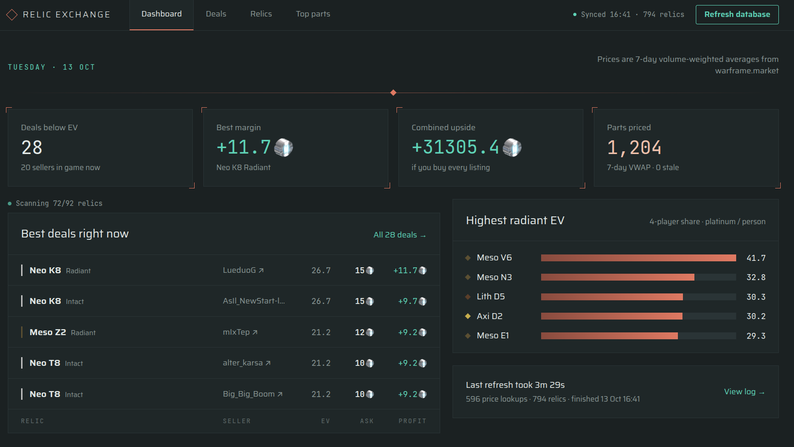
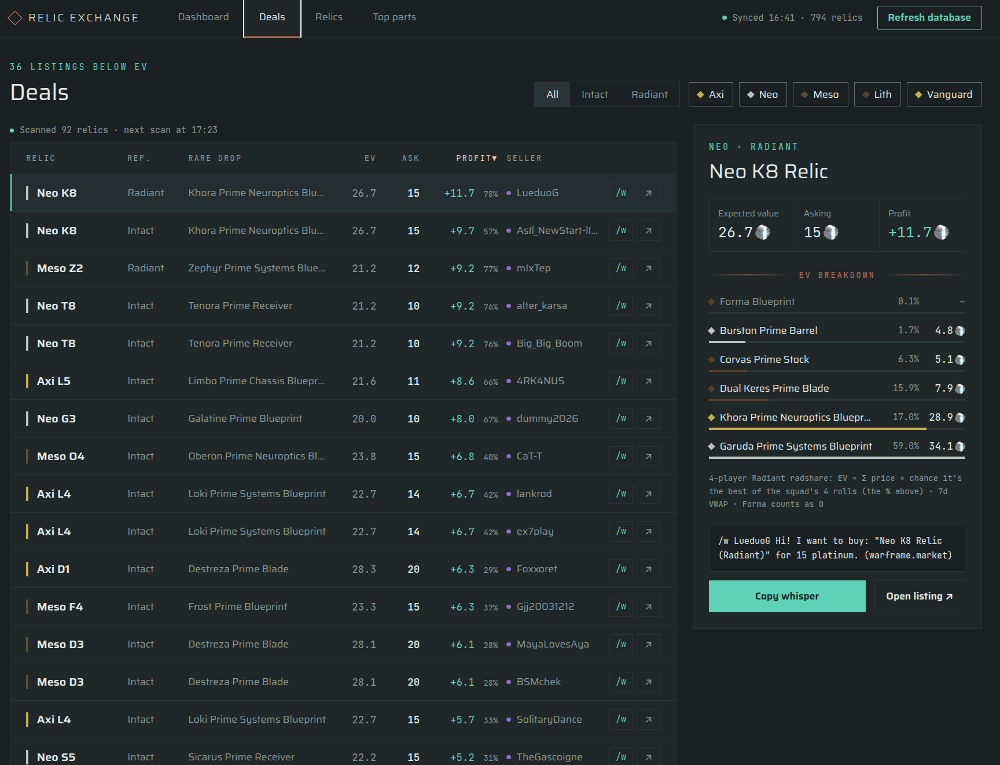
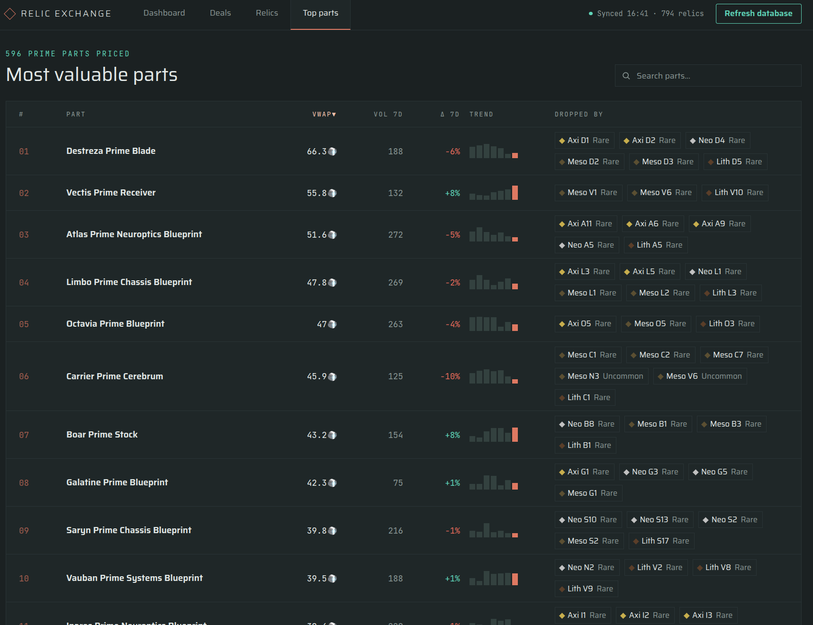
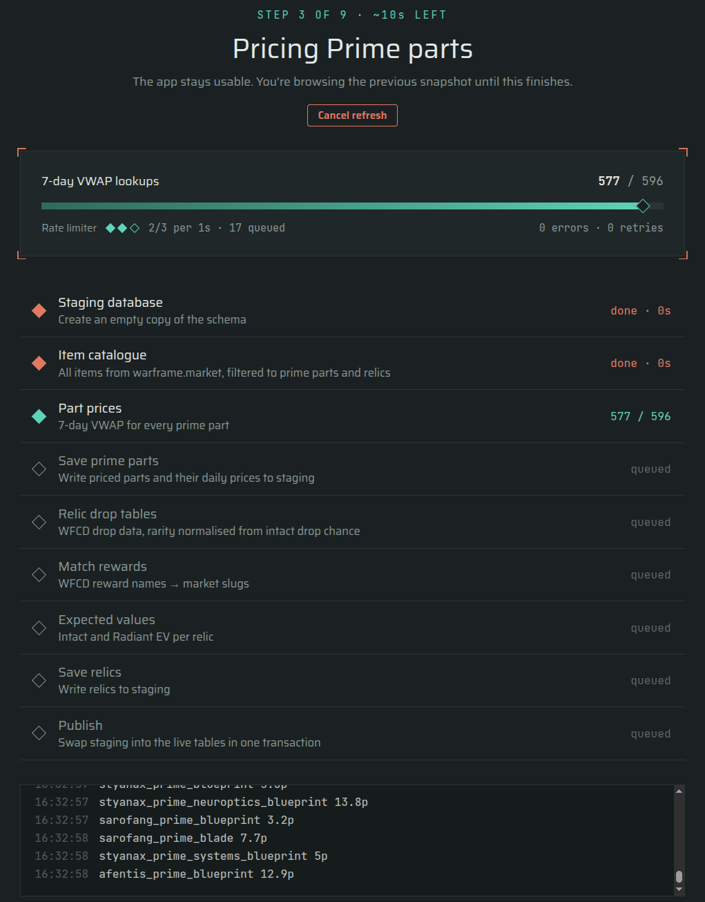
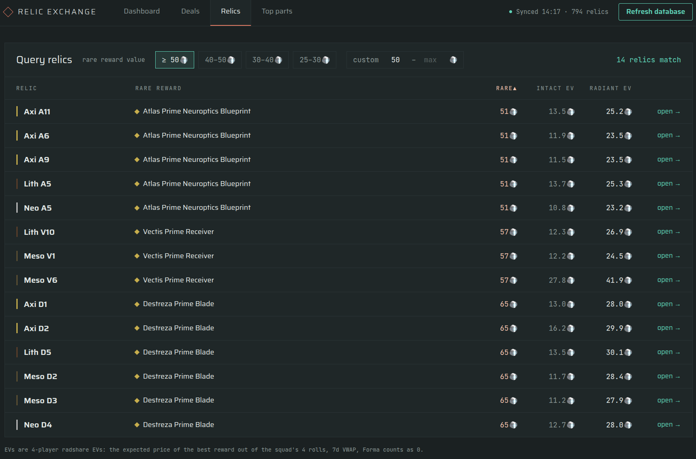
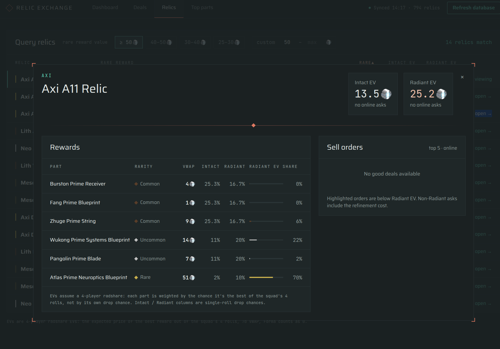

# Relic Deal Finder

A .NET web app that looks for underpriced Void Relics in Warframe. It works out what each relic is worth on average from live market data, then compares that with what players are selling it for.

<!-- TODO: add a screenshot or GIF of the UI here -->

## Background

Warframe players trade items for an in-game currency called platinum. Each relic opens into one of six Prime parts: three common, two uncommon and one rare. The drop chances are fixed and public, and the parts have market prices, so you can calculate a relic's expected value and compare it to its asking price. If the expected value is well above the price, it's worth buying.

There are around 800 relics and hundreds of Prime parts, so doing this by hand isn't realistic. I built this app to do it automatically.

## Features

- **Dashboard.** Shows the relics with the highest Radiant expected value, the best current deals, headline stats, and when the data was last refreshed.
- **Top parts.** Every tradeable Prime part ranked by 7-day price, with trade volume, 7-day price change and a trend sparkline. You can search and sort the list, and clicking a part shows which relics drop it.
- **Database refresh with live progress.** One click rebuilds all prices and relic values. The refresh page shows each step's progress, an ETA, a streaming log, error and retry counters, and a live readout of the rate limiter. You can cancel a refresh at any point without losing the existing data.
- **Background processing.** A refresh keeps running if you close the tab or move to another page. Every open page updates as it goes.
- **Deals.** Every listing currently priced below its relic's expected value, with filters for refinement and tier, and sorting by EV, ask and profit. Selecting a listing shows how its EV breaks down per reward, and you can copy the whisper message or open the listing on warframe.market.
- **Relics.** Query relics by the value of their rare reward, using preset price bands or a custom min/max range, and sort by rare price or Intact/Radiant EV. Opening a relic shows its rewards with drop chances and each part's share of the Radiant EV, next to the live sell orders, with the ones below EV highlighted.
- **Deal scanner.** Polls the cheapest online sell orders for valuable relics in the background, either all the time or only while someone has the Dashboard or Deals page open.
- **Discord notifications.** Posts new deals above a configurable profit to a Discord channel through a webhook, with the whisper message ready to copy.

## Screenshots

### Dashboard



### Deals



### Top parts



### Database refresh



### Relics





## How the value is calculated

1. **Pricing parts.** For every tradeable Prime part, the app pulls trade statistics from [warframe.market](https://warframe.market) and computes a 7-day volume-weighted average price (VWAP) over the last 7 *completed* UTC days:

   ```
   price = Σ(volume_d × avg_price_d) / Σ(volume_d)     over the last 7 days
   ```

   I went with VWAP over the lowest listing because a handful of troll or outdated listings can throw the lowest price off a lot.

2. **Mapping relics to rewards.** Relic contents come from the [Warframe Community Developers (WFCD)](https://github.com/WFCD/warframe-drop-data) drop data. Reward names are converted to warframe.market slugs, and untradeable rewards like Forma blueprints are skipped. Requiem relics are left out.

3. **Fixing rarities.** The same part can be rare in one relic and uncommon in another, and WFCD sometimes tags a part with the rarity it has in a different relic. To get around this, the app works out each reward's rarity from its actual drop chance in that specific relic.

4. **Expected value.** Calculated for both unrefined (Intact) and fully refined (Radiant) relics, with the same squad model for each: 4 players all open the same relic at the same refinement, and you get to pick the best of the 4 rewards. This is how relics are usually opened, and with Radiant relics it's known as a radshare. So the EV is the expected price of the best of 4 rolls, not of a single roll; only the drop chances differ between Intact and Radiant. Going through the rewards from most to least valuable:

   ```
   P(best = part) = (1 − c)⁴ − (1 − c − q)⁴
   EV = Σ price(part) × P(best = part)
   ```

   where `q` is the part's `dropChance(rarity, refinement)` and `c` is the combined drop chance of every more valuable part. Forma counts as 0.

   | Rarity   | Intact  | Radiant |
   |----------|---------|---------|
   | Common   | 25.33 % | 16.67 % |
   | Uncommon | 11 %    | 20 %    |
   | Rare     | 2 %     | 10 %    |

   Drop chances are from the [Warframe wiki](https://warframe.fandom.com/wiki/Void_Relic/Math#Drop_Chances).

## Technical highlights

### Refresh pipeline with an atomic publish

A refresh is a nine-step pipeline: catalogue, part prices, drop tables, reward matching, expected values, and so on. It never writes to the live tables while it runs. Instead:

1. It creates a separate **staging SQLite database**, built from the same EF Core migrations so the schema matches exactly.
2. All new data is written to staging.
3. In the final step, staging is `ATTACH`ed to the live database and every table is replaced (`DELETE` + `INSERT … SELECT`) in **one transaction**.

The app keeps reading the previous snapshot until that commit lands, so users never see half-written data. If the refresh fails or is cancelled, the staging file is deleted and the live data is untouched. Staging files left behind by a crash are cleaned up at the start of the next run.

### Background worker and coordinator

The refresh runs in a `BackgroundService`, not in the Blazor circuit that started it, which is why it survives closed tabs and navigation. A singleton `RefreshCoordinator` connects the UI and the worker:

- Start requests go through a bounded `Channel` with capacity 1, so two refreshes can't run at once.
- Cancellation uses a per-run `CancellationTokenSource`, linked to the app's shutdown token. A user cancel and an app shutdown are handled differently, and both are recorded in the run history.
- State is an immutable record, and each change swaps in a new copy under a lock.
- **Throttled UI updates.** Pricing logs hundreds of lines a second. Pushing a re-render for each one would flood the SignalR connection. Changes only set an atomic dirty flag, and a 250 ms timer turns that flag into at most one notification per interval. Important events, like start, finish and cancel, skip the timer.
- A subscriber that throws doesn't stop the other subscribers from being notified.

### Rate limiting against warframe.market

warframe.market allows 3 requests per second. Every request to it goes through one shared Polly resilience pipeline backed by a **token bucket** (1 token, refilled every 350 ms, unbounded queue):

- With no burst capacity, requests are spaced evenly instead of firing three at the start of each window.
- 350 ms instead of 333 ms leaves room for timer jitter, so the app never sends 4 requests in a second.
- Hundreds of price lookups are started in parallel and the limiter queues them, so the code stays simple while the request rate stays within the limit.
- The limiter is registered as its own singleton so the UI can read its statistics and show requests per second and queue depth live.

Prices are only fetched during a refresh and then stored in SQLite. Outside a refresh, the only requests are the deal scanner's order lookups, which share the same limiter.

### Deal scanner

A second `BackgroundService` polls the top 5 online sell orders of every relic with a Radiant EV of at least 20 platinum, one request at a time, then waits 5 minutes and starts over. Every listing is valued as if it was refined to Radiant, so non-Radiant asks get 2 platinum added for the refinement cost. A listing counts as a deal when its EV is at least 3 platinum above that cost. All of these numbers can be changed in the `Deals` section of `appsettings.json`.

- Scanning pauses while a refresh runs, so the refresh gets the rate limiter to itself and no deals are judged against EVs that are about to change.
- With `ScanWithoutViewers` on (the default), it scans all the time. With it off, a new cycle only starts while someone has the Dashboard or Deals page open, and a cycle that has already started still finishes if everyone leaves.
- Deals are kept in memory, not in the database, since they go stale within minutes anyway.

### Discord notifications

When a scan finds a deal with at least `NotificationProfitThreshold` platinum profit, the scanner posts it to a Discord webhook: relic, ask, Radiant EV, profit and the whisper message. Each listing is only sent once while it stays listed, and a failed notification is logged without stopping the scan. Notifications are off until a webhook URL is set.

## Tech stack

- .NET 10 / ASP.NET Core, Blazor (Interactive Server)
- Entity Framework Core + SQLite, code-first migrations
- Polly 8 with `System.Threading.RateLimiting`
- Tailwind CSS v4 (custom theme, no component library), compiled as part of `dotnet build`

## Running it

Requirements: .NET 10 SDK, Node.js with npm (the Tailwind build runs `npm install` on the first build), and the `dotnet-ef` tool.

```bash
cd RelicDealFinder
dotnet ef database update   # creates app.db
dotnet run
```

Open the app and click **Refresh database**. The first refresh takes a few minutes because every Prime part is priced one request at a time under the rate limit.

To get Discord notifications, create a webhook in your Discord server (Server settings → Integrations → Webhooks) and keep its URL out of the repo with user-secrets:

```bash
dotnet user-secrets set "Deals:DiscordWebhookUrl" "https://discord.com/api/webhooks/..."
```

Outside development, set the `Deals__DiscordWebhookUrl` environment variable instead. Settings are read at startup, so restart the app after changing them.
